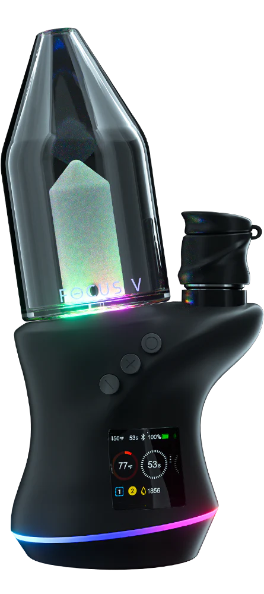
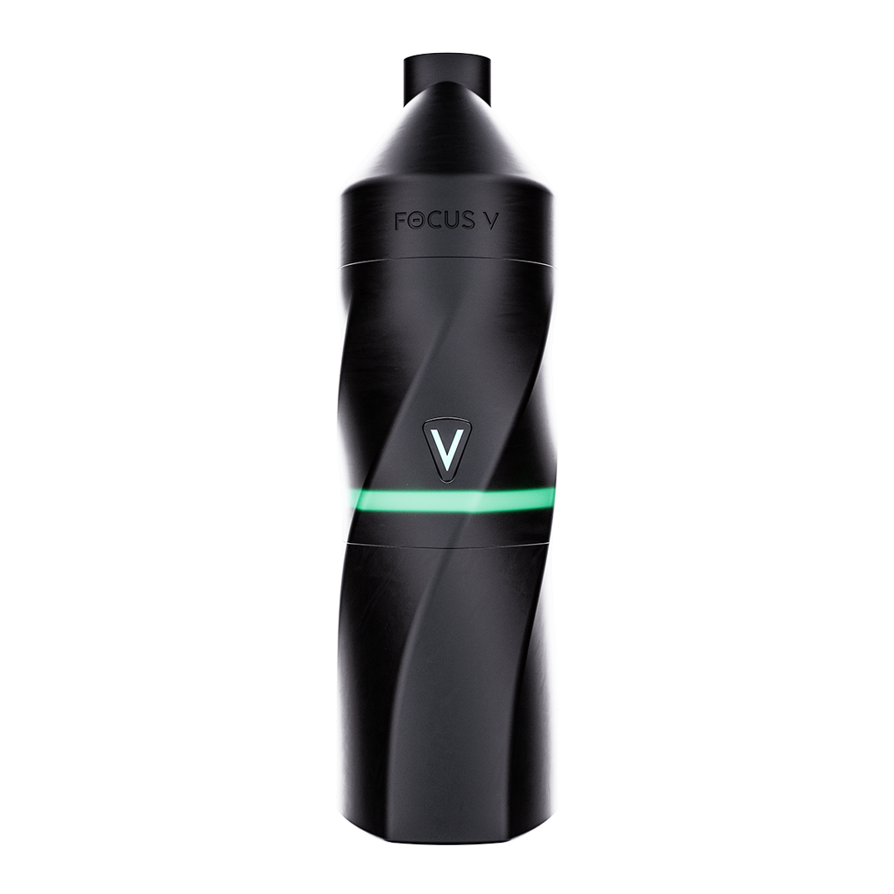
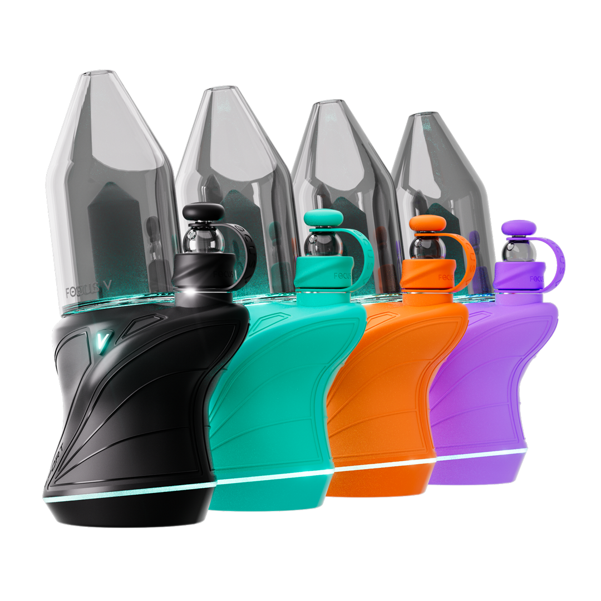

# focusv-ble-research

Independent, hobbyist reverse-engineering of the BLE protocol and firmware used by Focus V's
Carta 2 / Aeris / Carta Sport dab rigs (internally: the "Quantum/Aeris/Sport" device family).
Not affiliated with, endorsed by, or sponsored by Focus V. Done for interoperability, repair,
and personal-device-control purposes — building your own client, understanding what your own
hardware actually does, and diagnosing/recovering a device without depending on the official app.
See [`LEGAL.md`](LEGAL.md) for why this kind of work is on solid legal footing.

**Companion repo**: [focusv-ramp-firmware](https://github.com/hashking710/focusv-ramp-firmware) is
a firmware patch for all three devices, built on top of what's documented here and verified in
software (address traces, host tests), providing a phone-independent, on-device temperature ramp.
The user reports one completed ramp on an earlier patched Aeris image; the current rebuilt images
and Carta 2/Sport patched operation have not been hardware-validated. That repo is the patch itself;
this one is how every address and protocol detail it relies on was found.

<table>
<tr>
<td align="center" width="33%"> <b>Carta 2</b> "Quantum" internally</td>
<td align="center" width="33%"> <b>Aeris</b></td>
<td align="center" width="33%"> <b>Carta Sport</b> "Sport" internally</td>
</tr>
</table>

Product photos © Focus V (Aeris, Carta Sport) and [The Cloud Vortex](https://thecloudvortex.com)
(Carta 2), used here only to identify which hardware this research covers.

## Docs

| | |
|---|---|
| **[BLE Protocol Reference](docs/ble-protocol.md)** | GATT services/characteristics, packet framing, every write/notify opcode found, the real firmware-OTA and screensaver-image wire protocols |
| **[Firmware Architecture Reference](docs/firmware-architecture.md)** | Chip/toolchain, boot chain, the confirmed closed-loop PID temperature controller, thermal safety subsystem, flash layout, firmware self-update mechanism |
| **[Methodology](docs/methodology.md)** | How this was done, plus two non-obvious Ghidra/Telink-TC32 tooling gotchas worth knowing before repeating any of it |
| **[Hardware Setup Guide](docs/hardware-setup.md)** | Step-by-step instructions for the logic analyzer, SWD probe, and SWire recovery tooling — written for a hobbyist with basic soldering experience |
| **[Open Questions](docs/open-questions.md)** | What's still unresolved, as a current punch list |

## Tools

| | |
|---|---|
| **[`tools/focusv-controller.html`](tools/focusv-controller.html)** | A from-scratch Web Bluetooth controller; exports active-session `0x99` status-temperature CSV traces (encrypted `0xDD` is kept opaque) |
| **[`tools/ble-tester.html`](tools/ble-tester.html)** | A lower-level BLE opcode tester/logger with timestamped raw-notification capture, session markers, and JSON/CSV export for `0xDD`/`0x99` correlation |
| **[`tools/ota-flash.html`](tools/ota-flash.html)** | Pushes a firmware file to the device over Bluetooth using the real OTA wire protocol — works for a patched build or for pushing the original stock firmware back to fully revert |
| **[`tools/ghidra-scripts/`](tools/ghidra-scripts/)** | The Ghidra scripts used during firmware analysis (`DumpTC32.java`, `FindXrefs.java`, `dump_tc32.py`) |
| **[`tools/render_mockups.py`](tools/render_mockups.py)** | Renders a preview of the Carta 2 ramp-graph screen and the Aeris/Sport LED gradient, by re-implementing the patch's own drawing logic in Python against your own firmware dump — used to generate the mockup images in [focusv-ramp-firmware](https://github.com/hashking710/focusv-ramp-firmware) |

No build step for the HTML tools — open directly in a browser that supports Web Bluetooth
(Chrome or Edge; desktop or Android — iOS Safari doesn't implement Web Bluetooth).

## What's deliberately not here

This repo documents findings and cites specific addresses/line numbers rather than redistributing
Focus V's own copyrighted material:

- No firmware binaries. The docs cite specific offsets/addresses; get the actual `.bin` from
  Focus V's own update infrastructure (referenced, not mirrored, in the protocol docs) if you
  need to follow along in Ghidra yourself.
- No copy of the official app's JS bundle.
- No bulk Ghidra disassembly dumps — the architecture doc summarizes what's confirmed; the
  methodology doc explains how to reproduce the analysis from a firmware image you obtain
  yourself.

## Status

This is real, ground-truth-verified reverse-engineering (independently cross-checked between two
separate disassembly toolchains, and cross-referenced against the official app's own source where
possible) — not guesswork dressed up as fact. That said, some things remain genuinely unresolved;
see [`docs/open-questions.md`](docs/open-questions.md) rather than assuming silence means
"solved."

## Hardware validation roadmap

Static analysis of the current stock builds has identified the TLSR8258 heater-output routine and
the firmware's physical-button input path. These are software findings, not measurements of the
signals on a running board. Active BLE capture also cannot observe the official app and device at
once because the device accepts only one central connection. The next useful physical checks are:

- **A logic analyzer** (8-channel, 24MHz), to passively observe the SPI flash bus and correlate the
  firmware-traced heater-output and button-input signals with actual board behavior. See
  [Open Questions](docs/open-questions.md) for the remaining hardware questions.
- **An SWD probe**, to dump and identify the Nuvoton M031's own firmware. Its role is unknown; the
  earlier heater-driver theory was superseded by finding the heater-output routine in the
  TLSR8258 image. See [Firmware Architecture § Board hardware](docs/firmware-architecture.md#board-hardware).
- **SWire tooling for the TLSR8258 itself** — a separate requirement from the SWD probe above; see
  the Methodology doc for why.

Still planned, not yet sourced:

- **A passive BLE sniffer** (e.g. an nRF52840 dongle running an open-source BLE sniffer
  firmware/Wireshark plugin) — captures the over-the-air link layer directly, without
  establishing its own connection, so it can watch the real app and a real device talk to each
  other simultaneously. The real GATT write-callback, the erase mechanism, and why there's no
  finalize/copy step were all resolved by static analysis instead (see
  [Open Questions](docs/open-questions.md)) — what a sniffer would still add is confirming Carta
  2's own base address the same way, and the mask-ROM bootloader question that no amount of
  flash-image analysis alone can settle.

Update this roadmap with measured results when these checks are performed; static traces alone do
not close the hardware questions.

## Related

This research feeds into [**Terpline**](https://terpline.hkdev.run), which provides allowlisted beta
firmware flashing for Aeris, Carta 2 and Carta Sport. The web application is maintained separately
and is not part of this research repo.

## Contributing

Corrections, live-capture confirmations, and progress on anything in
[`docs/open-questions.md`](docs/open-questions.md) are all welcome — see
[`CONTRIBUTING.md`](CONTRIBUTING.md) for what makes a finding easy to act on, and the repo's
Issues tab (look for `help wanted`) for what's currently being asked for.

## License

MIT — see [`LICENSE`](LICENSE). See [`LEGAL.md`](LEGAL.md) for the legal reasoning behind doing
this kind of research in the first place.

---

Maintained by **[hashking.dev](https://hashking.dev)**.

 
